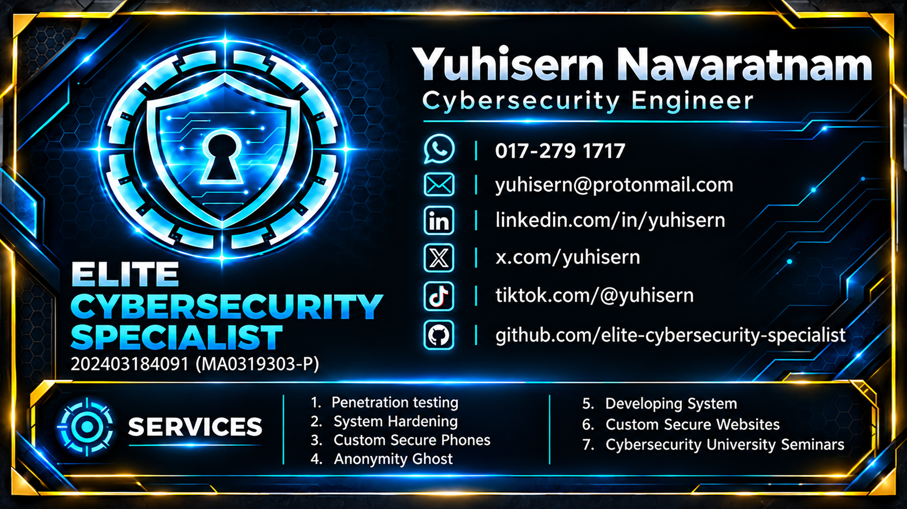
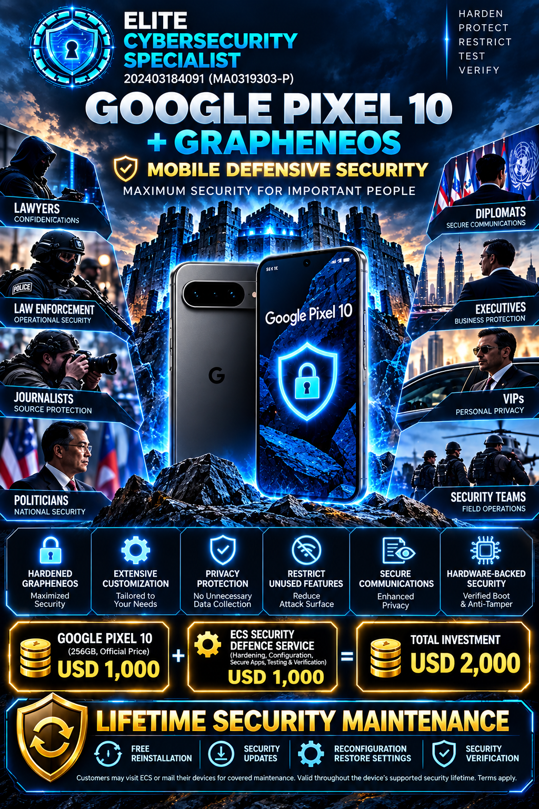
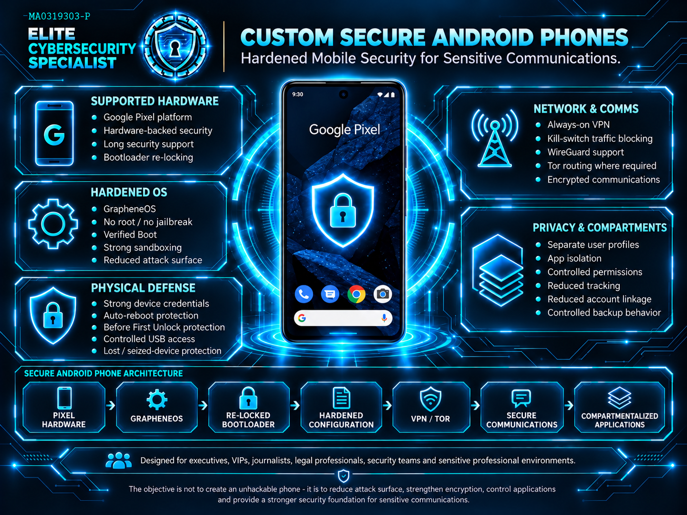
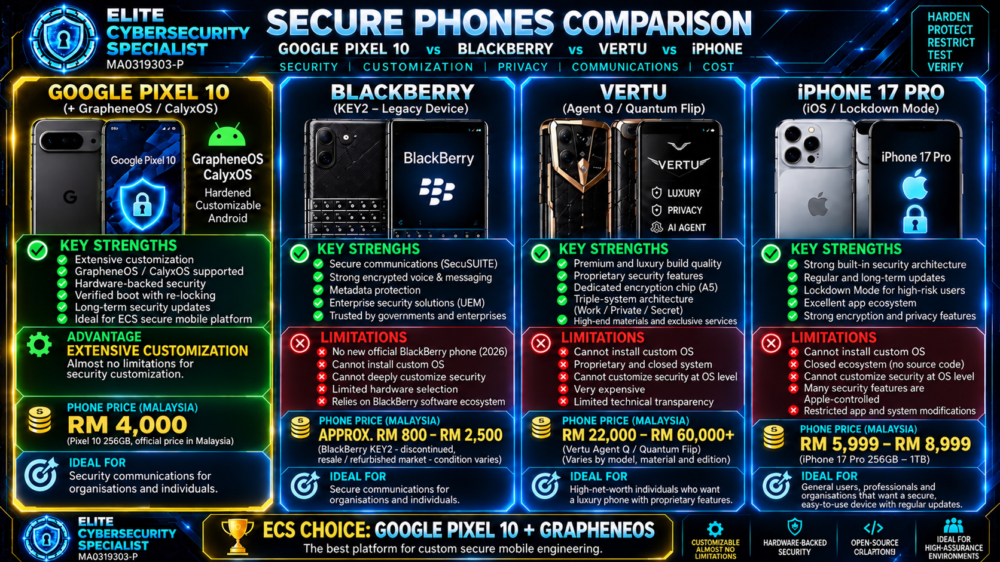

# ELITE CYBERSECURITY SPECIALIST

<div align="center">
  
</div>


<div align="center">
  
</div>

## CUSTOM SECURE ANDROID PHONES — MOBILE DEFENSIVE SECURITY

**GOOGLE PIXEL 10 + GRAPHENEOS | HARDENED FOR SENSITIVE COMMUNICATIONS**

**HARDEN. PROTECT. RESTRICT. TEST. VERIFY.**

> **Your phone is more than a phone.** It carries private conversations, contact networks, authentication sessions, confidential files and access to the systems you depend on. If the device is compromised, those relationships and assets can be put at risk. **ECS builds a more deliberate mobile security environment around what you actually need to protect.**

<div align="center">
  
</div>

<p align="center"><strong>Hardened Android. Controlled exposure. Privacy by design. Verified before handover.</strong></p>

<p align="center">
  <a href="#request-a-secure-phone"><strong>ENQUIRE ABOUT A SECURE PHONE</strong></a> ·
  <a href="#what-the-ecs-service-adds"><strong>WHY ECS?</strong></a> ·
  <a href="#advertised-investment"><strong>PRICING</strong></a> ·
  <a href="https://github.com/elite-cybersecurity-specialist/company-profile"><strong>COMPANY PROFILE</strong></a>
</p>

---

## Contents

- [The Mission](#the-mission)
- [Who This Service Is For](#who-this-service-is-for)
- [Why Pixel 10 + GrapheneOS?](#why-pixel-10--grapheneos)
- [What the ECS Service Adds](#what-the-ecs-service-adds)
- [Mobile Defensive Security Architecture](#mobile-defensive-security-architecture)
- [Security Layers and Customer Benefits](#security-layers-and-customer-benefits)
- [Privacy and Secure Communications](#privacy-and-secure-communications)
- [Our Security Engineering Process](#our-security-engineering-process)
- [Verification Before Handover](#verification-before-handover)
- [Secure Phone Comparison](#secure-phone-comparison)
- [Advertised Investment](#advertised-investment)
- [Lifetime Security Maintenance](#lifetime-security-maintenance)
- [Questions Customers Ask](#questions-customers-ask)
- [Security Reality and Independence](#security-reality-and-independence)
- [Request a Secure Phone](#request-a-secure-phone)
- [Technical References](#technical-references)

---

## The Mission

**ELITE CYBERSECURITY SPECIALIST (ECS)** is a Malaysia-based cybersecurity company focused on reducing digital attack surfaces and protecting sensitive environments.

Our mobile service starts with a straightforward question: **What would it mean for you if someone accessed your phone, intercepted your communications, or obtained your authenticated accounts?**

Many customers do not need another collection of security apps. They need a carefully selected device, a secure operating-system foundation, practical restrictions, application separation, communication controls, validation and a maintenance plan that makes sense for their work.

**Our objective is not to sell an “unhackable phone.” It is to make the device significantly harder to compromise, reduce unnecessary exposure, and give the owner a defensible, maintainable security configuration.**

### What the customer is buying

| A conventional setup | The ECS security-engineering approach |
|---|---|
| Accept most factory-default settings | Select controls against a documented use case and threat model |
| Install security apps without understanding interactions | Configure the operating system, apps, network and account boundaries together |
| Assume an alternative OS alone is sufficient | Verify installation, boot integrity, permissions, networking and essential functions |
| Mix personal, work and sensitive activities | Plan deliberate profile and account separation where practical |
| Consider setup complete when the phone boots | Provide handover guidance and covered maintenance during the supported device lifetime |

The distinction matters: **GrapheneOS provides the hardened OS. ECS's service is the planning, configuration, integration, validation and customer support layered around it.**

---

## Who This Service Is For

Our intended customers include people and teams whose phones handle information that warrants more careful protection:

| Customer | Typical protection priority |
|---|---|
| **Executives & business owners** | Business accounts, private meetings, communications and account access |
| **VIPs & high-profile individuals** | Reduced unnecessary exposure, personal privacy and device-loss planning |
| **Lawyers & confidential advisers** | Client confidentiality, compartmentalized cases and document handling |
| **Investigative journalists** | Source protection, identity separation and sensitive communications |
| **Diplomats & public officials** | Role-based account separation, secure communication practices and device controls |
| **Law enforcement & security personnel** | Authorized operational communications and reduced device exposure |
| **Security teams & privacy-conscious organizations** | Repeatable configuration and evidence-oriented validation for approved use cases |

A real deployment begins by understanding a customer's **threat model**, essential apps, operational constraints and acceptable trade-offs. The same configuration will not be appropriate for everybody.

---

## Why Pixel 10 + GrapheneOS?

**Google Pixel 10 is officially supported by GrapheneOS.** The combination gives ECS a strong, documented platform for mobile hardening: supported firmware updates, hardware-backed Android security, alternative-OS installation with a re-lockable bootloader, and a hardened Android operating system focused on exploit prevention and privacy.

GrapheneOS builds on Android's existing protections and adds work on exploit mitigation, attack-surface reduction, application containment, privacy controls and device security. It also supports optional sandboxed Google Play where needed for app compatibility.

### Selection principles

1. **Supported hardware, not a novelty handset.** Use a model listed by the OS developer for production support; verify the exact device variant can be unlocked.
2. **Preserve verified boot.** A hardened OS should be installed correctly, with the bootloader re-locked and the installed system verified.
3. **Avoid rooting or bypassing the security model.** Customization should not casually weaken the protections that justified choosing the platform.
4. **Keep updates viable.** A secure device needs ongoing OS and firmware support, not only an impressive initial setup.
5. **Choose privacy controls that are usable.** A configuration the customer cannot operate safely is not a complete solution.

**Support horizon:** GrapheneOS's device-support FAQ lists the Pixel 10 OEM minimum support end as **August 2032**. Actual upstream support and available updates should be checked at purchase and during maintenance.

**Official technical sources:** [GrapheneOS supported devices](https://grapheneos.org/faq#supported-devices) · [GrapheneOS features](https://grapheneos.org/features) · [Official installation guidance](https://grapheneos.org/install/web)

---

## What the ECS Service Adds

**Installing GrapheneOS is an important starting point—not the whole service.** ECS proposes an engineering-led configuration and verification workflow tailored to the customer.

| ECS service layer | What it contributes |
|---|---|
| **Security consultation** | Identify sensitive activities, required applications, expected threats, travel and communication needs |
| **Device and OS preparation** | Check supported Pixel hardware, prepare the device and perform documented OS installation |
| **Verified-boot assurance** | Re-lock the bootloader and verify the installation using appropriate device checks |
| **Configuration hardening** | Set relevant screen-lock, auto-reboot, connectivity, USB, permission and privacy controls |
| **Application compartmentalization** | Separate selected activities through user profiles, permissions and controlled app sourcing |
| **Network and communications policy** | Configure agreed VPN, routing, DNS and secure messaging arrangements, subject to compatibility |
| **Functional validation** | Verify essential calling, messaging, authentication, updates and approved applications after hardening |
| **Owner handover** | Explain the security configuration, operational trade-offs and what to do after device loss or suspicion of compromise |
| **Ongoing maintenance** | Covered reinstallation, security updates, configuration restoration and verification, under the stated terms |

**The objective is an integrated security baseline, not the largest number of toggles switched on.** Each control should have a reason, a verification step and an operational owner.

---

## Mobile Defensive Security Architecture

<div align="center">
  
</div>

The proposed layered design connects the device, operating system, user behavior and communications environment:

```text
SUPPORTED GOOGLE PIXEL 10 HARDWARE
               |
               v
 OFFICIAL GRAPHENEOS INSTALLATION
               |
               v
    RE-LOCKED BOOTLOADER + VERIFICATION
               |
               v
   THREAT-MODEL-BASED HARDENING
               |
               +--> SCREEN LOCK / AUTO-REBOOT / USB CONTROLS
               +--> APP PERMISSIONS / PRIVACY CONTROLS
               +--> SEPARATE USER PROFILES AND ACCOUNTS
               +--> CONTROLLED VPN / DNS / OPTIONAL TOR
               +--> ENCRYPTED COMMUNICATIONS
               |
               v
  TESTING + CUSTOMER HANDOVER + MAINTENANCE
```

See [Security Architecture and Threat Model](docs/SECURITY_ARCHITECTURE.md) for the layer-by-layer technical overview.

---

## Security Layers and Customer Benefits

| Security area | Proposed controls | Why they matter |
|---|---|---|
| **Secure boot & OS integrity** | Official GrapheneOS build, locked bootloader, verified-boot checks, supported firmware | Reduces opportunities for undetected persistent modification |
| **Exploit resistance** | GrapheneOS exploit mitigations, hardened apps/browser, minimized exposure | Raises the difficulty of exploiting vulnerabilities |
| **Lost-device defense** | Strong passphrase/PIN, automatic reboot, appropriate USB controls | Helps protect device data during loss, theft and physical access |
| **Application control** | Selective installation, permissions review, isolation, profile boundaries | Limits unnecessary app access to sensitive information |
| **Identity separation** | Distinct profiles, accounts and communication contexts where suitable | Reduces accidental mixing of high-risk and everyday activity |
| **Network policy** | VPN lockdown options, DNS settings, controlled Wi-Fi and mobile-data use | Reduces selected network exposure and routing mistakes |
| **Encrypted communications** | Approved end-to-end encrypted apps and identity verification practices | Improves protection of communications where configured and correctly used |
| **Recoverability** | Agreed backup/recovery approach, update plan, configuration records | Makes secure operation maintainable beyond installation day |

**Important distinction:** Many baseline protections belong to Google Pixel hardware, modern Android and GrapheneOS. ECS does not claim to have invented those features. The value of the ECS service is **how they are selected, configured, tested and supported together**.

---

## Privacy and Secure Communications

Sensitive communications require more than a privacy-themed app. The endpoints, the people using them, their accounts and their operational habits all matter.

Depending on the customer requirements, ECS may configure:

- **Compartmentalized user profiles** for ordinary activity versus sensitive work, with intentionally limited app overlap.
- **Permission review** for camera, microphone, files, contacts, sensors and network access as appropriate.
- **Always-on VPN with traffic blocking**, where compatible and operationally justified.
- **Encrypted DNS and controlled network configuration** to address selected name-resolution and connection risks.
- **Tor-based workflows** only for suitable tasks and applications, with awareness of speed, compatibility and anonymity limitations.
- **End-to-end encrypted messaging** and contact verification practices selected to fit the customer, rather than assuming one application is universally best.
- **Backup and incident procedures** for lost phones, account compromise and secure device replacement.

A VPN does **not** make a user anonymous to their cellular carrier. Encrypted messaging does **not** protect messages after an unlocked or compromised endpoint exposes them. These distinctions are part of responsible security planning.

---

## Our Security Engineering Process

**ASSESS → DESIGN → INSTALL → HARDEN → VALIDATE → HAND OVER → MAINTAIN**

| Stage | Intended process | Customer outcome |
|---|---|---|
| **01 — Assess** | Identify sensitive data, communication needs, must-have apps and acceptable constraints | Clear objectives and requirements |
| **02 — Design** | Select device, profiles, controls, routing and recovery approach | A proposed security blueprint |
| **03 — Install** | Use official supported GrapheneOS installation and lock the bootloader | Supported OS foundation |
| **04 — Harden** | Apply the approved configuration; install and scope the necessary apps | Reduced unnecessary exposure |
| **05 — Validate** | Check OS authenticity/boot state, network routing, permissions and essential functions | Evidence the agreed controls are in place |
| **06 — Hand over** | Explain daily operation, updates, trade-offs and emergency steps | Usable protected communications |
| **07 — Maintain** | Perform covered maintenance within the device's supported security lifetime | An ongoing support path |

**Service principle:** Every restriction needs a purpose; every important change needs a check. We do not recommend breaking necessary customer functionality merely to increase the number of security settings.

Read the proposed [Deployment and Verification Standard](docs/DEPLOYMENT_AND_VERIFICATION.md).

---

## Verification Before Handover

A professional device deployment should be testable. Depending on the agreed scope and device capabilities, ECS's proposed acceptance checks include:

- [ ] Confirm model and GrapheneOS production support status.
- [ ] Confirm OS installation completed using the intended release channel.
- [ ] Confirm the bootloader is re-locked and relevant device integrity checks pass.
- [ ] Review OS, firmware and security update status.
- [ ] Test screen-lock and agreed physical access restrictions.
- [ ] Review installed applications, profile separation and sensitive permissions.
- [ ] Test approved VPN / DNS / routing behavior and relevant failure modes.
- [ ] Test required calls, messaging, authentication and business applications.
- [ ] Review backup / recovery approach and owner training.
- [ ] Record any exceptions and obtain agreement before handover.

These are **proposed service checks**, not a claim that every device has already passed them. Actual evidence is produced for a customer engagement when performed and included in scope.

---

## Secure Phone Comparison

<div align="center">
  
</div>

**Why ECS selects Pixel 10 + GrapheneOS for this particular service:** support for a hardened alternative OS, a strong verified-boot model, current security updates, and the ability to engineer a controlled Android configuration around individual requirements.

This is **a platform-selection decision for ECS's mobile-hardening workflow, not a claim that every competing device is insecure**. iPhone offers meaningful built-in protections; legacy BlackBerry devices and luxury proprietary devices serve different product markets. Real security depends on supported software, deployed settings, threat model, service life and operational practices.

*The comparison artwork is an illustrative promotional graphic. Device prices, availability, specific operating-system compatibility and manufacturer features may change; confirm current specifications and pricing directly with the respective vendors. The production OS selected in this offer is **GrapheneOS**.*

---

## Advertised Investment

**Flagship example: Google Pixel 10 + ECS Mobile Defensive Security setup**

| Item | Advertised amount |
|---|---:|
| Google Pixel 10 handset allocation (advertised 256 GB configuration) | **USD 1,000** |
| ECS security defence service — hardening, configuration, secure apps, testing and verification | **USD 1,000** |
| **Illustrative total investment** | **USD 2,000** |

**Why the service fee exists:** customers are paying for configuration engineering, careful integration, verification, client-specific guidance and the covered maintenance commitment—not merely an operating-system download.

**Price transparency:** The USD 1,000 device line is the amount used in ECS's advertisement, **not a representation of Google's official retail price**. Google Store pricing, local availability, import costs, tax, shipping and exchange rates may differ. A final written quotation should confirm the exact device/storage, included services, any additional costs and applicable maintenance conditions before purchase.

For scope and service boundaries, see [Service Scope and Maintenance](docs/SERVICE_SCOPE_AND_MAINTENANCE.md).

---

## Lifetime Security Maintenance

### Security is an ongoing process—not a one-day installation

ECS advertises **Lifetime Security Maintenance** for the covered mobile-hardening service. The intended meaning is **support during the supported security lifetime of the supplied device**, subject to agreed service terms—not an unlimited device replacement warranty or a promise of permanent immunity from cyberattacks.

**Advertised covered maintenance activities:**

| Included maintenance activity | Intended service |
|---|---|
| **Security reinstallation** | Reinstall the supported OS and restore the agreed baseline where justified and feasible |
| **Security updates** | Assist with supported OS/security update issues and configuration impact checks |
| **Configuration restoration** | Restore documented ECS settings to the agreed baseline where feasible |
| **Security verification** | Recheck supported integrity/configuration items during a covered maintenance visit |

Customers may **visit ECS or mail in the device** for covered work, subject to appointment, shipping arrangements, identity/ownership verification and written terms.

**Key boundaries:** Hardware damage, device replacement, lost data, third-party subscription fees, shipping, customs and unsupported devices are not automatically included. Maintenance does not extend the OS vendor's or handset maker's security-support period. Data loss may occur during reinstallations; customers need an agreed backup plan. Exact coverage and any applicable charges must be confirmed in writing.

Full proposed terms: [Service Scope and Maintenance](docs/SERVICE_SCOPE_AND_MAINTENANCE.md).

---

## Questions Customers Ask

**Is this simply a Pixel with GrapheneOS installed?**  
No. GrapheneOS is the OS foundation. The ECS offering is the proposed assessment, threat-model-based hardening, app and communications configuration, functional validation, handover guidance and covered maintenance.

**Will every customer receive exactly the same configuration?**  
No. A journalist protecting sources, a lawyer protecting client files and a business executive using mandatory enterprise apps may require different configurations and trade-offs.

**Can I still use my required applications?**  
Compatibility is assessed before configuration. Some applications require services or features that conflict with particular privacy settings; we should agree on necessary exceptions before delivery.

**Does the phone become invisible, untraceable or impossible to hack?**  
No. The purpose is to reduce risk and unnecessary exposure, not to promise anonymity under all conditions or absolute resistance to compromise.

**Does ECS develop GrapheneOS?**  
No. GrapheneOS is an independent open-source project. This offer uses official GrapheneOS builds on supported hardware; ECS provides a separate professional configuration and support service.

**Who controls the device and passwords?**  
The customer should retain ownership of their device, identities and secrets. Any exception involving managed credentials or remote management requires explicit agreement.

**Can an existing Pixel be used?**  
Potentially, if it is officially supported, can be unlocked, has a suitable support horizon and meets the customer's needs. Installation normally wipes existing data, so backup and ownership checks are essential.

**Is the USD 2,000 total a guaranteed worldwide fixed price?**  
It is the advertised example. A final quotation must confirm handset sourcing, taxes, shipping, availability, exact scope and terms.

---

## Security Reality and Independence

A responsible security service does not promise perfect security. A hardened phone can still be affected by social engineering, stolen credentials, malicious apps, physical coercion, carrier-level exposure, supplier outages, device loss or as-yet-unknown vulnerabilities.

ECS aims to reduce realistic risk by combining a strong platform with deliberate configuration, controlled exposure, practical verification and ongoing support. The owner's security habits and organizational environment remain essential.

**Independent service notice:** ELITE CYBERSECURITY SPECIALIST is an independent security service provider. It is not presented as affiliated with, sponsored by or endorsed by Google, GrapheneOS, Apple, BlackBerry or Vertu. Product names belong to their respective owners. Device images and visual comparisons are illustrative.

**No unauthorized access:** The service concerns customer-owned or expressly authorized devices. No security testing or configuration is performed on systems without permission.

---

## Request a Secure Phone

**Tell us what you need to protect. We'll discuss the appropriate device, applications, communications model and security configuration before proposing a final scope.**

**ELITE CYBERSECURITY SPECIALIST**  
Business registration: **202403184091 (MA0319303-P)**  
Based in **Malaysia**

- **Email:** [Yuhisern@protonmail.com](mailto:Yuhisern@protonmail.com)
- **WhatsApp:** [+60 17-279 1717](https://wa.me/60172791717)
- **Company profile:** [elite-cybersecurity-specialist/company-profile](https://github.com/elite-cybersecurity-specialist/company-profile)
- **GitHub organization:** [elite-cybersecurity-specialist](https://github.com/elite-cybersecurity-specialist)

**For an enquiry, include:** your country, preferred Pixel model (if any), required applications, number of devices, whether you already own the phone, and the general category of security/privacy concerns. **Do not send passwords, sensitive case details or confidential operational information in an initial message.**

> **HARDEN THE DEVICE. PROTECT THE COMMUNICATION. RESTRICT THE EXPOSURE. VERIFY THE RESULT.**

---

## Technical References

These independent primary sources support the underlying platform statements. They do not certify ECS's proposed services or attest to a particular customer's device configuration.

- [GrapheneOS — Official device support and support duration](https://grapheneos.org/faq#supported-devices)
- [GrapheneOS — Features and threat-mitigation design](https://grapheneos.org/features)
- [GrapheneOS — Official installation and verified-boot instructions](https://grapheneos.org/install/web)
- [GrapheneOS — Usage guidance](https://grapheneos.org/usage)
- [Google Store — Pixel 10 product configuration and current regional pricing](https://store.google.com/config/pixel_10?hl=en-US)

<sub>ELITE CYBERSECURITY SPECIALIST | Mobile Defensive Security | October 2026. Service descriptions and pricing are proposals subject to device compatibility, individual assessment and written engagement terms. Product screenshots and promotional artwork are illustrative.</sub>
